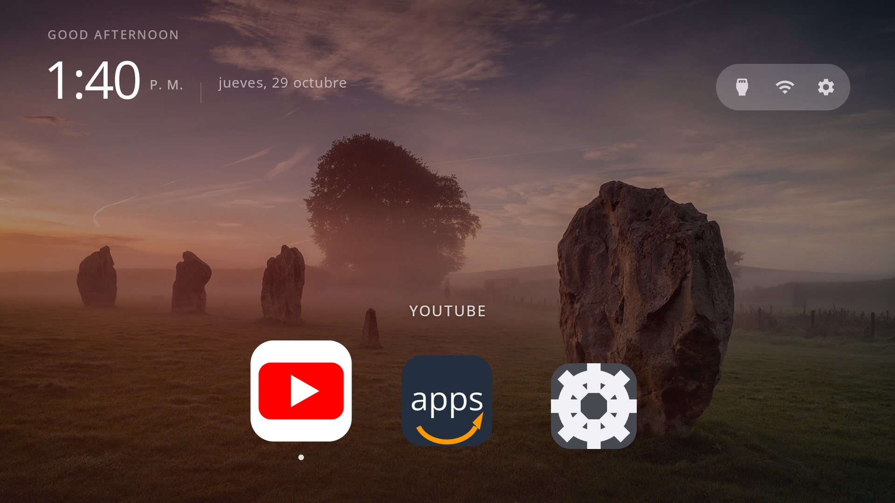

# fire-tv-cleanup

**Your TV, minus the ads.** Debloat an Android TV, Google TV or Fire TV over ADB and give it a
clean launcher with a Material-style dock and a daily Bing wallpaper. Hand the prompt to a coding
assistant, answer a few questions about which apps you use, and it does the rest on the real TV.

Forked from [itsmeterrylin/fire-tv-cleanup](https://github.com/itsmeterrylin/fire-tv-cleanup)
(itself from [Gathin23/tv-vibehack](https://github.com/Gathin23/tv-vibehack)). This fork keeps Fire
TV support and adds the launcher look below.



Everything is reversible: packages are disabled, never uninstalled, and a restore script puts the
stock launcher back.

## Quick start

1. On the TV: Settings → Device Preferences → About → press OK on **Build** seven times → back →
   Developer options → turn on **USB debugging** (and Network/ADB debugging if your TV shows it).
   Keep the TV on and on the same Wi-Fi as your computer.
2. Open a coding assistant on your computer and paste the prompt from
   [`PROMPT.md`](PROMPT.md), filling in your TV model.
3. Accept the "Allow USB debugging?" prompt on the TV when told to, then answer the checklist
   questions (which apps you use, which apps go in the dock).

That's it. The assistant backs up, debloats, builds and installs the launcher, and verifies each
step with screenshots from the TV. If you'd rather do it by hand, the pieces are below.

## What's in the repo

| Path | What it is |
|---|---|
| [`PROMPT.md`](PROMPT.md) | The prompt. Brand-neutral; the assistant discovers your TV's bloat. |
| [`launcher/`](launcher/) | The home launcher. Edit `app/src/main/res/values/config.xml` for your dock, hidden apps and Live TV package, then run `build-and-install.sh`. |
| [`tools/tv.py`](tools/tv.py) | Pure-Python ADB client (shell, batch, push, pull). Works where the stock `adb` is blocked. |
| [`tools/b64push.py`](tools/b64push.py) | Uploads larger files (APKs) as base64 chunks with an md5 check. |
| [`tools/disable.sh`](tools/disable.sh), [`tools/restore.sh`](tools/restore.sh) | Apply or undo a debloat list. |
| [`examples/`](examples/) | Per-TV debloat lists. Add yours, see [CONTRIBUTING.md](CONTRIBUTING.md). |

## The launcher

A small native Android TV home screen (`com.gathin.tvhome`), built for sticks with ~1 GB of RAM:

- **Bing picture of the day** as the home background (cached on device, refreshed about every 20
  hours). Falls back quietly when offline.
- Material-inspired dock: full-bleed tiles, quiet focus label, minimal chrome so the photo stays
  the hero.
- Pin, unpin and reorder dock apps on the TV: hold OK or press Menu on an app.
- Round buttons top right: **Wi-Fi** and **Settings** (Inputs only on real TVs with HDMI). Greeting,
  clock and date top left ([Open Sans](https://fonts.google.com/specimen/Open+Sans)); focused app
  name at ~⅓ height on the left.
- A screensaver of local photos with a slow zoom and a clock.

Configure it in [`launcher/app/src/main/res/values/config.xml`](launcher/app/src/main/res/values/config.xml):
the starting dock, hidden apps, Live TV package and columns. To put your name in the greeting, add
`tvhome.userName=Alex` to `launcher/local.properties`. To replace the time-of-day greeting entirely
(e.g. a fixed welcome line), edit the `good_*` strings in
[`launcher/app/src/main/res/values/strings.xml`](launcher/app/src/main/res/values/strings.xml).
Brand dock icons (YouTube, Netflix, Twitch, Kick, VLC, DAZN, etc.) are not committed (trademarks).
Generate them on any machine with [`tools/make_dock_icons.py`](tools/make_dock_icons.py) before
building — same script works for every TV. Generic tiles (Settings gear, browser globe) are in the
repo. On the TV you can pin/unpin, reorder dock + grid, and hide/show apps (Menu / hold OK; gear →
Show Hidden Apps). Build and install with

```bash
TV_HOST=192.168.1.50 launcher/build-and-install.sh
```

Needs JDK 17 and the Android SDK (platform 34, build-tools 34.0.0). On macOS:
`brew install openjdk@17 android-commandlinetools && sdkmanager "platforms;android-34" "build-tools;34.0.0"`.

## Talking to the TV by hand

```bash
python3 -m venv tools/venv && tools/venv/bin/pip install -r tools/requirements.txt
export TV_HOST=192.168.1.50                                   # your TV's IP
tools/venv/bin/python -I tools/tv.py --probe                 # model, Android version, firmware
tools/venv/bin/python -I tools/tv.py 'pm list packages'      # one command
printf 'cmd1\ncmd2\n' | tools/venv/bin/python -I tools/tv.py --batch
tools/disable.sh examples/xiaomi-mi-tv-4a/debloat.txt        # apply a list
tools/restore.sh examples/xiaomi-mi-tv-4a/debloat.txt        # undo it, restore stock launcher
```

### Gotchas we hit

- **macOS: `adb connect` says "No route to host"** while the port is clearly open. Recent macOS
  treats the Google-signed `adb` as its own app under Local Network privacy and silently blocks it.
  `tools/tv.py` avoids the binary entirely.
- **No "wireless debugging" toggle** on some TVs (Xiaomi among them). USB debugging alone opens
  network ADB on port 5555.
- **Chained `pm` commands** (`pm disable a; pm disable b`) may silently stop after the first. Run
  one per shell call; `--batch` does this.
- **Large pushes hang** through the Python client. Use `tools/b64push.py` for APKs.
- **Disable the stock launcher only after the new one is installed**, or the Home button lands on
  a factory test app.
- **Third-party launchers** often charge for basics like a custom wallpaper. Hence `launcher/`.
- **No on-screen keyboard** after switching launchers (seen on Xiaomi): the default input method
  pointed at a Baidu IME that isn't installed. Fix with
  `tools/tv.py 'ime set com.google.android.inputmethod.latin/com.android.inputmethod.latin.LatinIME'`.

## Fire TV

Fire OS is Android underneath, but it guards its home screen. Tested on:

- Hisense Fire TV Edition (Fire OS 8, Android 11, model AFTOLCBC82)
- Amazon Fire TV Stick 4K 2nd gen (AFTKM / karat, Fire OS 8 / Android 11) — see
  [`examples/amazon-fire-tv-stick-4k-2ndgen-AFTKM/`](examples/amazon-fire-tv-stick-4k-2ndgen-AFTKM/)


To set it up:

1. On the TV, open **Settings → Device & Software → About**, select the device name seven times,
   then go back to **Developer Options** and turn on **ADB debugging**.
2. Run `TV_HOST=<tv ip> launcher/build-and-install.sh`. On Fire TV it installs the launcher, turns
   on its Home redirect and sets its screensaver. It leaves Amazon's launcher alone.
3. Optional: disable the ad and telemetry packages with
   `tools/disable.sh examples/amazon-fire-tv-stick-4k-2ndgen-AFTKM/debloat.txt` (or the Hisense list).

How it differs from Android TV:

- **Amazon's launcher stays.** Fire OS ignores the default-home setting, and Amazon's launcher also
  hosts Settings. Disabling it locks you out of Settings. The launcher's `HomeRedirectService`
  opens the launcher whenever Amazon's home screen comes up, so Amazon's screen shows for a moment
  before yours. That flash is expected.
- **Settings keeps working.** Fire OS often hosts Settings inside `com.amazon.tv.launcher`. The
  redirect waits briefly so Settings can open, then brings you back when Amazon Home returns.
- **If you land on Amazon Home,** a **← Home** button appears (or press **Menu**). The app is also
  listed under Your Apps as **Home** (`LEANBACK_LAUNCHER`).
- **To turn the redirect off on the TV,** open the gear menu and choose **Switch to Amazon Home**.
  Menu / ← Home still brings you back.
- **ADB turns off when the TV restarts.** Turn **ADB debugging** back on in Developer Options
  before you connect again.
- **Some packages are protected.** Fire OS refuses to disable packages listed as protected in the
  example notes. Undo the rest with `tools/restore.sh` and the same list.
- **Silk** often cannot be uninstalled; `pm disable-user` + `hidden_apps` is enough.
- **OTA** can be limited with `disable-user` / suspend on OTA packages, but without root Amazon can
  still push updates later. Root on AFTKM needs USB (not network ADB alone).
- **AirPlay has no screen of its own.** The AirPlay tile opens nothing, and casting from an iPhone
  works anyway.

## Supported TVs

Android TV and Google TV: Xiaomi/Redmi, TCL, Hisense, Sony, OnePlus, Realme, Nvidia Shield and most
others. Fire TV: see [Fire TV](#fire-tv). Not Samsung Tizen or LG webOS. Tested so far on the models
in [`examples/`](examples/).

## Contributing

Add your TV's debloat list, improve the launcher, or sharpen the prompt. See
[CONTRIBUTING.md](CONTRIBUTING.md).

## Licence

MIT, see [`LICENSE`](LICENSE). The Outfit and Open Sans typefaces are under the SIL Open Font
License, see `launcher/FONT-LICENSE-OFL.txt`. Photo credits are in [`CREDITS.md`](CREDITS.md).
Bing wallpapers remain © Microsoft / the photographers; the launcher only downloads the public
HPImageArchive asset to the device.
